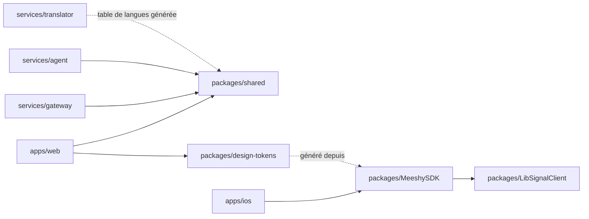
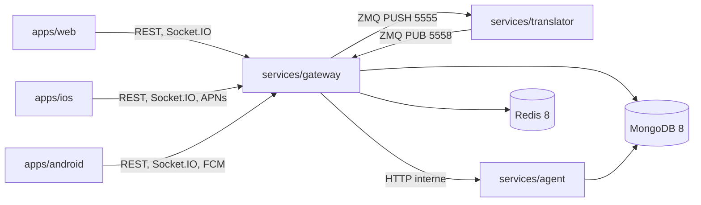

# Graphe de dépendances

Mesuré sur `dev @ 467263ce24 (2026-11-27)`.

## Construction (workspaces)

Aucun cycle. `packages/shared` n'importe rien d'une application ni d'un service. Aucune source de production ne traverse entre applications et services.

## Exécution

## Consommateurs de `packages/shared`

| Consommateur | Comment | Ce qu'il lit |
|---|---|---|
| `services/gateway` | workspace, `dist/` et client Prisma | types, schémas Zod, événements Socket.IO, chiffrement, Prisma |
| `services/agent` | workspace, `dist/` et client Prisma | types, Prisma |
| `apps/web` | workspace, `dist/` | types, Prisme, présence, accent, points d'accès |
| `services/translator` | fichier généré | `generated_languages.py` depuis `utils/language-codes.ts` |
| `apps/ios`, `packages/MeeshySDK`, `apps/android` | miroirs écrits à la main | contrats Socket.IO, Prisme, présence, tenus par des gardes de parité |

Un changement dans `packages/shared` touche donc les neuf produits : six par le compilateur ou un générateur, trois par des gardes de texte.

## Imports hors zone

180 fichiers de test du web lisent des sources de la passerelle par chemin relatif. Aucune dépendance de workspace ne le déclare ; la voie de parité (`scripts/ci/voie-parite.mjs`) les rejoue à chaque poussée.

## Écarts de versions entre manifestes

| Paquet | Versions demandées |
|---|---|
| `typescript` | `^7.0.2` dans shared, `^6.0.3` ailleurs |
| `prisma`, `@prisma/client` | `^6.15.0` dans shared, `^6.19.3` dans passerelle et agent |
| `zod` | `4.4.3` exact dans le web, `^4.4.3` ailleurs, épinglé 4.4.3 par `overrides` |
| `jest`, `ts-jest`, `pino`, `dotenv`, `mongodb` | une version mineure d'écart entre agent, passerelle et racine |
