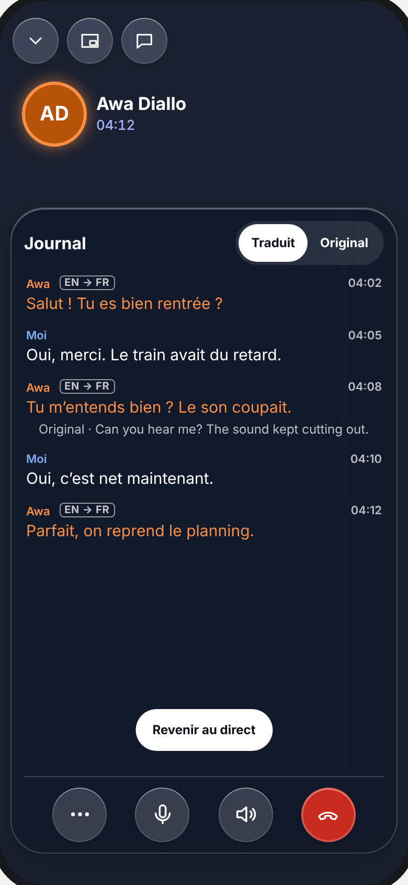

# Appels audio et vidéo : la vue finale

> **La cible que web (`apps/web`, coque Capacitor comprise), Android natif (`apps/android`) et iOS (`apps/ios` + `packages/MeeshySDK`) doivent atteindre.** Approche « C adaptée », retenue par le porteur le 2026-09-27, complétée par la décision #16612 (2026-11-06) sur l'ordre des sous-titres et par les directives du 2026-11-07 (couleur, gestes, partage, capture). Issue : #16633. Toute évolution de la vue d'appel se lit contre ce fichier. Une directive porteur postérieure le supplante, et c'est alors l'issue fermée qui fait foi.

- Planche (toutes les vues, ouvrable dans un navigateur) : [`appels-vue-finale/planche.html`](appels-vue-finale/planche.html)
- Captures : [`appels-vue-finale/vues/`](appels-vue-finale/vues/). Elles se régénèrent d'une seule commande, `node docs/product/appels-vue-finale/capture.mjs`, et aucune n'est posée à la main.
- Planches d'origine, éphémères : l'artifact « C adapté ». Le fichier du dépôt fait foi, jamais une URL.

**Conformité = disposition, hiérarchie, états et gestes.** Les polices, rayons et teintes exactes viennent du design system de chaque plateforme (`MeeshyColors.swift`, `packages/design-tokens/ios.css`). Les couleurs d'auteur, elles, ne se choisissent pas : elles sortent de la fonction partagée (loi 4).

## Les lois

1. **Une seule pilule de verre, en bas : (…) · Micro · Sortie · Fin.** Fin est en rouge. Un bouton actif est un disque blanc plein à icône sombre.
   - **Les boutons sont en Liquid Glass quand la version d'iOS le permet, en verre dessiné sinon** (directive porteur du 2026-11-09, #17323). Elle supplante « un bouton inactif n'a pas de fond » et « jamais de verre posé sur du verre » ; les captures montrent désormais le disque de verre de chaque bouton.
   - Le Liquid Glass l'emporte : sur iOS 26 et plus, chaque bouton est un verre interactif, avec l'effet au toucher des boutons de l'en-tête de conversation (`ConversationHeaderGlassGlyph`), et les verres voisins se composent dans un même conteneur.
   - Sur iOS 16 à 25, le bouton est le verre dessiné de `adaptiveLiquidGlass`. Android transpose par `MeeshyGlassSurface`.
   - **La capsule de droite de l'en-tête** (décision porteur du 2026-11-09, #17341) : en vidéo, elle porte le nom que j'ai donné à la personne (sinon son nom d'affichage) et la durée, « Awa · 04:12 » ; l'indicateur réseau n'y apparaît que si la connexion se dégrade. En audio, le nom et la durée sont déjà au centre sous l'avatar : la capsule n'existe que pour l'indicateur réseau, et seulement s'il se dégrade. En groupe, elle porte le nom du groupe, le nombre et la durée.
2. **(…) fait sortir les actions, et les range.**
   - En duo, deux rails verticaux sortent vers les bords. **Gauche = mon image** : Caméra, Retourner, Effets, Écran ; caméra éteinte, seulement Caméra et Écran, car un contrôle sans effet n'est pas posé (porteur, 2026-11-10). **Droite = l'appel** : Sous-titres, Enregistrer, Ajouter, Journal, Réagir, Capture.
   - **La liste « l'appel » ne porte que ce qui n'a pas déjà sa place ailleurs** (décisions porteur du 2026-11-09, #17329 : « il faut garder » ce que le code porte en plus, « ajouter ce qui n'existe pas encore ailleurs », et la planche s'enrichit « sans doublon de ce qu'elle rend déjà autrement », #17332). La conversation s'ouvre par l'en-tête (#8436) et l'image dans l'image y a son bouton : l'en-tête porte, de gauche à droite, Réduire · Image dans l'image (si l'appel y est éligible, ou pour en sortir) · Conversation (si elle est connue). Rien ne disparaît : Messages et Image dans l'image passent à l'en-tête, Journal, Réagir et Capture entrent dans la liste.
   - En groupe, les mêmes dix actions montent dans la pilule, qui s'agrandit en deux rangées légendées (mon image, puis l'appel).
   - **Les deux dispositions se tiennent selon le nombre de participants** (directive porteur du 2026-11-09, #17327) : à plusieurs, aucun rail ne se pose par-dessus la grille, pour ne masquer aucune vignette.
   - L'ordre et le vocabulaire sont les mêmes sur les trois plateformes.
3. **Le verre est adaptatif.** Sur un contenu clair (un écran partagé), il s'assombrit pour garder le contraste, en-tête et pilule compris.
4. **Chaque personne a UNE couleur, partout dans l'appel et après** (#16612, #16614, précisée par le porteur le 2026-11-07, #16662).
   - La graine est `authorAccentColor(userId, name)` (`@meeshy/shared`). Ses miroirs sont `DynamicColorGenerator.colorForName(userId)` sur iOS et `CallSpeakerColor` sur Android. L'identifiant prime sur le nom, et il n'y a jamais de seconde palette.
   - Cette couleur teinte :
     - le liseré de la vignette, **la mienne comprise** ;
     - l'anneau de qui parle, avec son halo : il n'apparaît QU'À LA PAROLE, et rien ne l'annonce au repos (pas d'anneau permanent). Il en va de même quand sa caméra est coupée et que son avatar prend la place de l'image (G4, P9 ; famille 2, 2026-11-11) ;
     - **le pseudo, toujours** ;
     - **la phrase, SEULEMENT quand elle sert une traduction**.
   - Une phrase originale reste à l'encre du thème (blanc sur le verre d'appel, noir ou blanc dans le fil selon le thème) :
     - ma parole, jamais traduite pour moi ;
     - une phrase déjà dans ma langue ;
     - l'original déplié sous une traduction, qui est en encre secondaire.
   - La couleur est rendue lisible (AA 4,5:1) sur son fond par le plus petit pas possible :
     - sur le verre d'appel : web `speakerColor`, iOS et Android `CallSpeakerColor` (adaptée au sombre) ;
     - dans le fil : web `authorInk`, iOS et Android `CallSpeakerColor` adaptée au schéma.
5. **Le sous-titre part tout de suite dans l'original, et la traduction le rejoint DANS LA MÊME LIGNE** (#16612, #16613).
   - L'original s'affiche dès qu'il est reconnu, étiqueté de sa langue (« EN ») ; trois points disent qu'une traduction arrive.
   - La traduction remplace l'original sur place, comme un message, et l'étiquette devient « EN → FR ».
   - Une phrase non finale reste pâle jusqu'à sa version finale.
   - Ma phrase n'est jamais traduite pour moi.
   - La ligne servie descend le **Prisme** du lecteur (`resolvePrismTranslation` / `served`), jamais `translations[0]`.
   - **Les sous-titres vivent DANS la pilule**, au-dessus de sa rangée de base, dans le même verre, en duo comme en groupe (décision porteur du 2026-11-09, #17343). Ouvrir les actions (…) les range ; refermer les actions les rend.
   - **La bande et le journal rangent les phrases dans le MÊME ordre : par début de phrase** (l'heure dans l'appel où la phrase a commencé), la plus ancienne en haut, la plus récente en bas, contre la rangée. Une traduction ou une version finale qui arrive plus tard met la ligne à jour sur place, sans la déplacer : en P3 et P4, la phrase d'Awa reste au-dessus de ma réponse même si sa traduction arrive après (compte rendu famille 1, #17329).
6. **Toucher une phrase montre son original dessous** ; la retoucher le replie. « Journal » ouvre tout l'appel, DANS la pilule, à la place des sous-titres (#17343).
   - **En appel audio, le journal ouvert RÉDUIT l'avatar** (décision porteur du 2026-11-11, #17529 ; P9b). L'avatar passe de 120 pt à ~56 pt et monte en un en-tête compact, sous l'en-tête de l'appel : l'avatar à gauche, et à côté, sur la même rangée, le nom puis la durée (iOS `CallCompactAudioHeader`). Le journal prend la place libérée ; la personne ne disparaît jamais derrière lui, et son anneau de parole suit l'avatar à sa nouvelle taille.
     - Seul le journal ouvert DANS la pilule réduit l'avatar : les sous-titres le laissent à 120 pt, et l'avatar reprend sa taille dès que le journal n'est plus dans la pilule (journal fermé, (…) ouvert par-dessus, pilule rangée au toucher, loi 11).
     - La transition est un morphisme : l'avatar glisse et se réduit vers l'en-tête compact pendant que le nom et la durée le rejoignent en fondu (≈ 200 ms, transformation et opacité seulement), puis le chemin inverse au retour. Réduire les animations ⇒ un fondu seul, sans déplacement ni changement d'échelle.
7. **Le journal est FIDÈLE, pendant et après l'appel.**
   - C'est le MÊME journal avant et après la fin de l'appel : mêmes phrases, même ordre, mêmes couleurs, même descente du Prisme.
   - L'original : pendant l'appel, il se déplie sous la phrase qu'on touche, comme dans la bande ; après l'appel, il est sous chaque traduction (décision porteur du 2026-11-09, #17340).
   - Pendant l'appel, toucher une phrase déplie son original sous elle seule (#17340). La bascule Traduit · Original de la tête du journal fait passer TOUT le journal dans l'autre texte ; elle ne touche pas la bande des sous-titres, qui reste dans la langue du lecteur (Prisme). Après l'appel, l'original se lit sous chaque traduction, et la bascule y inverse les deux lignes (#17862, ci-dessous).
   - Pendant l'appel, il s'ouvre dans la pilule, au-dessus de la rangée de base, et y défile ; ouvrir les actions (…) le range (#17343). Ma vignette garde sa place, en haut à droite, pendant qu'il est ouvert (porteur, 2026-11-10 ; P6). Sur un écran large (web), il se pose en colonne à droite (W1) ; cette colonne ne masque rien et reste ouverte quand on ouvre (…) (porteur, 2026-11-10).
   - Rien n'est tronqué, et une ligne dont la traduction arrive après la fin de la phrase est mise à jour sur place, pas dupliquée. Les règles de fusion sont web `mergeCaption`, iOS `CallTranscriptMergeRules`, Android `CallLiveJournal.merged`.
   - Après l'appel, il se déplie sous la bulle d'appel du fil et dans le détail de l'historique.
   - **Après l'appel, la bascule INVERSE les deux lignes, sur tout l'appel** (décision porteur du 2026-11-13, #17862). C'est la même bascule Traduit · Original que celle du journal vivant (P6).
     - Par défaut, la traduction servie par le Prisme est la ligne principale, et « Original · … » est dessous (#17340).
     - « Voir l'original », au pied du journal, fait de l'original la ligne principale de chaque phrase traduite. La traduction passe dessous, étiquetée « Traduit · … ».
     - Le libellé devient alors « Voir la traduction », qui rend l'état par défaut.
     - Rien ne disparaît. Une phrase sans traduction (la mienne, ou une phrase déjà dans la langue du lecteur) reste seule dans les deux états.
     - La bascule n'est offerte que si une phrase au moins est traduite.
     - En tête, l'original reste à l'encre du thème et la traduction à la couleur de son auteur (loi 4). La ligne dessous garde la même place, le même retrait et l'encre secondaire, qu'elle dise « Original · » ou « Traduit · ».
     - Le passage d'un état à l'autre se fait en fondu ; avec Réduire les animations, il n'y a aucun déplacement.
     - Exemple : Awa a dit « Nos vemos mañana », traduit « On se voit demain ». Par défaut, le journal montre « On se voit demain » et, dessous, « Original · Nos vemos mañana ». Après « Voir l'original », il montre « Nos vemos mañana » et, dessous, « Traduit · On se voit demain ».
   - Pendant l'appel :
     - le défilement est libre ;
     - « Revenir au direct » apparaît dès qu'on a remonté ;
     - le journal survit à l'appel réduit, aux sous-titres coupés et à une reconnexion.
8. **Micro coupé = ma parole n'est plus transcrite** (#8475).
9. **Effets = des looks : filtres, cadres, effets de visage, de paysage et de voix.** La directive porteur du 2026-11-10 (#17409) rend les effets de voix, que #8050 avait retirés le 2026-09-27 ; elle est postérieure et la supplante.
   - **Effets emprunte au composer** (directive porteur du 2026-11-10, #17406) : les filtres, les cadres et les effets sont des LOOKS, choisis en surimpression sur mon image, dans la bande du composer (`ComposerLookStrip`), et les puces qui les trient (`ComposerLookFilterChips` : Tout · Filtres · Cadres · Visage · Paysage · Voix…) apparaissent dans la barre du bas (P8). Elles défilent à l'horizontale sans coupure brute : la rangée s'efface toujours en fondu à gauche comme à droite (#17409). L'appel ne recrée ni la bande, ni les puces, ni le catalogue.
10. **L'écran partagé de quelqu'un d'autre passe à la une tout seul.** La caméra de celui qui partage passe en médaillon, au liseré de sa couleur.

11. **Un toucher n'importe où sur l'image range tout, un autre toucher rend tout** (#16663).
    - Le premier toucher cache l'en-tête, la pilule, les rails et les bandeaux, et ma vignette passe à sa petite taille.
    - Le second toucher fait revenir les contrôles partout, et ma vignette reprend la taille que j'avais choisie.
    - Il n'y a pas de minuterie. Un bouton touché pendant le fondu répond quand même.
    - Les sous-titres et une carte d'accord (enregistrement, cadre) ne se cachent jamais : quand la pilule se range, les sous-titres restent dans un verre sans sa rangée de base (G1). Il en va de même en mode Effets : les sous-titres restent dans ce verre sans rangée, posé au-dessus des looks (P8) ou du panneau de réglages (P8b).
    - **Un SEUL verre se resserre** (famille 2, 2026-11-11) : au premier toucher, le verre qui portait les sous-titres au-dessus de la rangée perd sa rangée par morphisme (loi 17) et reste le même verre ; il n'y a jamais de second verre posé pour les sous-titres rangés, sur aucune plateforme. En-tête, rails et pilule sortent vers leurs bords, et reviennent par le chemin inverse.
    - **Le cycle G1 → G2 rend l'état d'avant** : si (…) était ouvert, il revient ouvert ; les sous-titres que (…) rangeait restent rangés ; ce qui était fermé reste fermé.
    - **Un journal ouvert dans la pilule se range avec elle** au premier toucher et revient avec elle au second. Sur grand écran, la colonne du journal (W1) reste : elle ne masque rien (décision porteur).
    - Contrôles cachés, toucher ma vignette rend d'abord les contrôles, comme toucher l'image.
12. **Lancer un partage d'écran RÉDUIT l'appel** (#16664).
    - Je quitte Meeshy pour montrer autre chose, et l'appel me suit en capsule : icône d'écran, nom · durée, « Arrêter ».
    - Toucher la capsule rouvre l'appel ; le bandeau « Vous partagez votre écran · Arrêter » y reste sous l'en-tête.
    - Mon partage ne passe jamais à la une chez moi.
13. **Une capture ou un enregistrement d'écran se voit et se garde** (#16665).
    - Une puce rouge « X capture l'écran de l'appel » apparaît chez tous, en audio comme en vidéo.
    - Une ligne datée entre dans le journal et reste dans celui d'après l'appel.
    - L'enregistrement demande l'accord de tous, sur une carte qui ne se cache jamais, et le journal note son début et sa fin.
    - **Contrat (#16665), rétrocompatible.** `call:screen-capture-detected` porte un `kind` optionnel, `recording` (enregistrement d'écran, `isCapturing` vrai puis faux) ou `screenshot` (capture ponctuelle, `isCapturing` vrai seul). Un `kind` absent se lit `recording`, ce qu'envoient les clients d'avant. La passerelle relaie `kind` dans `call:screen-capture-alert`. Elle persiste chaque DÉBUT (`isCapturing` vrai) dans `CallCaptureEvent` (`callSessionId`, `participantId`, `userId?`, `kind`, `offsetMs`, `createdAt`), au plus une ligne par participant, par sorte et par fenêtre de 5 s. L'enregistrement CONSENTI de l'appel (`call:recording-started` / `call:recording-stopped`, aucun fil client nouveau) s'y écrit aussi, par la passerelle là où elle diffuse ces deux événements : `kind` vaut `call-recording-started` (au nom de l'enregistreur) ou `call-recording-stopped` (seulement s'il avait commencé ; `participantId` et `userId` nuls quand personne ne l'a demandé : fin d'appel, délai, arrivée). `GET /calls/:callId/transcript` ajoute `captures: [{ id, participantId, userId, displayName, kind, offsetMs, at }]` à côté de `segments` (les trois champs d'auteur peuvent être nuls pour un arrêt d'enregistrement ; une sorte inconnue s'ignore). Les clients insèrent ces lignes à leur heure, dans le journal vivant comme dans celui d'après l'appel : « Awa a capturé l'écran » ou « Awa enregistre l'écran », « L'enregistrement de l'appel a commencé » ou « L'enregistrement de l'appel s'est arrêté », en encre secondaire, sans couleur d'auteur sur la phrase (le pseudo garde la sienne).
14. **Options en surimpression.**
    - Une option à réglages (Enregistrer, Réagir) s'ouvre DANS la pilule, par morphisme : la même barre s'allonge et grandit pour la contenir, avec ‹ Retour et Fermer, puis reprend sa forme (loi 17). C'est la même barre agrandie qui porte les sous-titres et le journal.
    - **Retour, Fermer et (…) pendant une option** (famille 2, 2026-11-11 ; G3) : « ‹ Retour » rend le MENU, les actions de (…) ouvertes et leurs rails revenus ; « Fermer » rend la pilule de base, tout rangé ; (…) touché pendant l'option la referme comme Fermer. Le glyphe de Retour est le chevron ‹, celui de P8 et P8b, jamais le chevron vers le bas de Réduire.
    - **Enregistrer** : le titre « Enregistrer l'appel » au centre, la phrase « Tout le monde doit accepter », puis deux puces larges et ÉGALES, Audio et Vidéo, dans le verre de l'appel. Toucher l'une lance aussitôt la demande d'accord (R2) et referme l'option : il n'y a ni bouton de lancement, ni choix à confirmer, ni puce mise en avant.
    - « Ajouter » (la liste « l'appel », loi 2) ouvre la feuille des personnes ; « Journal » s'ouvre dans la pilule (loi 7).
    - Effets est un mode plein écran qui parle la langue du composer (directive porteur du 2026-11-10, #17409) : ‹ · Réglages · (+). Réglages porte un engrenage et sa légende « Réglages », pour ne pas se confondre avec le glyphe d'Effets ; il ouvre P8b, où il passe en disque blanc.
    - **P8b, l'arrivée des réglages** (famille 2, 2026-11-11) : le panneau Luminosité · Flou du fond est un VERRE SÉPARÉ, posé au-dessus de la barre, à la place de la bande de looks. La barre perd sa rangée de puces (Filtres · Cadres · Visage…) et se resserre par morphisme sur ‹ · Réglages · (+). Les looks et les puces partent en fondu pendant que le panneau monte depuis la barre en fondu, en ≈ 200 ms (transformation et opacité) ; « Réduire les animations » ne garde que le fondu. Retoucher « Réglages » rend la bande de looks et ses puces par le chemin inverse. Les sous-titres restent au-dessus de tout, dans un verre sans rangée (loi 11), et le bandeau des autres reste comme en P8.
    - Le look touché s'applique tout de suite, sans « Valider » ; ‹ revient à l'appel ; (+) ajoute un look par-dessus le précédent, pour les cumuler ; « Aucun » rend mon image d'origine. Le choix se fait dans les looks du composer (loi 9).
    - **Effets, filtres et cadres sont UNE famille d'outils, avec la même barre et la même navigation, Montage compris** (décision porteur du 2026-11-13, #16979 ; P8, C1). Elle supplante la barre Quitter · Cadre · Valider du Montage.
      - La barre est partout `‹ · Réglages · (+)`, sous les puces qui trient les looks. En Montage, la puce « Cadres » est pressée et le carrousel des cadres prend la place de la bande de looks.
      - **La validation est automatique** : il n'y a de « Valider » nulle part. Ce qui est touché s'applique aussitôt, et ‹ revient à l'appel en gardant les effets appliqués.
      - **Après le choix d'une fonction, la barre revient à son menu de base** : un look, un cadre ou un réglage choisi, ce que la fonction avait ouvert se referme par le chemin inverse (loi 17) et la barre retrouve ses puces et `‹ · Réglages · (+)`.
      - **Au plus trois couches d'effet s'empilent** (un cadre, un filtre, une déformation…). (+) en ajoute une par-dessus les autres ; avec trois couches, (+) n'en ajoute plus de quatrième, le dit à son étiquette d'accessibilité et garde son appui long.
      - **Un appui long sur (+) montre la liste des effets appliqués**, de la couche du dessus à celle du dessous, chacun avec de quoi l'annuler. En annuler un retire cette couche seule, les autres gardent leur ordre, et la liste se referme : la barre revient à son menu de base, comme après tout choix. Le lecteur d'écran offre la même liste par une action nommée sur (+), sans appui long.
      - La pile est une loi PURE, la même sur les trois plateformes (ajouter, retirer, plafond de trois, ordre) : TS, Swift et Kotlin en sont des miroirs.
    - Un mode libère l'écran : l'en-tête se masque (#8578, confirmé par le porteur le 2026-11-09, #17344).
15. **À la une.**
    - Toucher une vignette la met à la une, choix local jamais imposé. Si les contrôles sont cachés, le toucher les rend d'abord.
    - La vignette à la une n'a pas de badge : une capsule en haut à droite offre « Revenir à la grille » et « Plein écran ».
    - Le bandeau des autres est en bas en portrait, en colonne en paysage.
    - Pincer zoome sur un écran partagé jusqu'à 4×, deux tapes reviennent à 1×.
16. **Cadres en direct, en duo vidéo.**
    - Je choisis un cadre dans Montage (ambiances, carrousel, déclinaisons par balayage vertical, option « Cadre »), dont la barre est celle d'Effets, `‹ · Réglages · (+)`, sans « Valider » (loi 14, #16979). Il s'applique chez moi et se PROPOSE à l'autre (« Non merci » · « Appliquer »).
    - Le proposeur apprend la réponse en une capsule.
    - Le cadre tombe si l'appel passe à trois.
17. **Rien n'apparaît ni ne disparaît d'un coup** (directive porteur du 2026-11-10, #17406).
    - Un élément arrive depuis l'endroit d'où il vient, et repart vers lui.
    - Les rails latéraux entrent par le bord de l'écran et sortent par lui, vers l'extérieur.
    - Ce qui s'ouvre depuis la barre du bas (options, sous-titres, journal, rangées d'actions en groupe) s'ouvre par morphisme : la barre s'allonge et grandit, puis reprend sa forme.
    - Une rangée qui défile (puces, bandeau de vignettes) n'est jamais coupée net : elle s'efface en fondu à ses deux bords (#17409).
    - Tout ce qui se pose par-dessus l'image suit la même logique. Seule exception : Effets, qui emprunte au composer (loi 9).
    - Dans Effets, les réglages (P8b) arrivent depuis la barre : la bande de looks et les puces partent en fondu, le panneau de verre monte depuis la barre en fondu (≈ 200 ms), la barre se resserre par morphisme ; retoucher « Réglages » les rend par le chemin inverse (loi 14).
    - Le mouvement ne perd aucune image, reste interruptible (loi 11) et « Réduire les animations » le remplace par un fondu court.
18. **Simplicité : la vue affiche ce qu'elle dessine, rien en plus** (directive porteur du 2026-11-10, #17406).
    - Aucun extra : ni libellé, ni badge, ni bouton, ni panneau d'appoint que la vue ne montre pas.
    - Rien de ce qui existe ne se recrée : un lot réutilise ou étend le composant, la loi et le texte déjà là.
    - Le verre est partout l'atome adaptatif (`adaptiveLiquidGlass` sur iOS, `MeeshyGlassSurface` sur Android, la surface de verre partagée sur le web).

## Les vues

### Duo vidéo, portrait

| P1 · Repos | P2 · Actions affichées | P3 · L'original d'abord | P4 · La traduction rejoint la ligne |
|---|---|---|---|
|  |  |  |  |

| P5 · Toucher = l'original | P6 · Journal pendant l'appel | P7 · Micro coupé | P8 · Effets de ma caméra |
|---|---|---|---|
|  |  |  |  |

### Gestes et options

| G1 · Un toucher : tout se range | G2 · Un autre toucher : tout revient | G3 · Option en surimpression | G4 · Caméra coupée |
|---|---|---|---|
|  |  |  |  |

Dans Effets (P8, P8b) comme dans Montage (C1), la barre est `‹ · Réglages · (+)` : ce qui est touché s'applique, la barre revient à son menu de base après chaque choix, (+) empile jusqu'à trois couches et son appui long liste les effets appliqués pour en retirer un (loi 14, #16979).

| P8b · Effets : réglages |
|---|
|  |

### À la une

| U1 · Une personne à la une | U2 · Écran à la une, plein écran | U3 · À la une, paysage |
|---|---|---|
|  |  |  |

### Je partage mon écran

| S1 · L'appel se réduit en capsule | S2 · De retour dans l'appel |
|---|---|
|  |  |

### Cadres en direct

C1 a la barre d'Effets (P8) : les puces, « Cadres » pressée, puis `‹ · Réglages · (+)`. Le cadre touché s'applique aussitôt, l'option « Cadre » le garde pour les deux et le propose ; un appui long sur (+) liste les effets appliqués, trois au plus, pour en retirer un (loi 14, #16979).

| C1 · Choisir un cadre | C2 · La proposition chez l'autre | C3 · Cadre appliqué |
|---|---|---|
|  |  |  |

### Capture et enregistrement

| R1 · Quelqu'un capture l'écran | R2 · Demande d'enregistrement | R3 · Enregistrement en cours |
|---|---|---|
|  |  |  |

### Duo audio

En audio, la personne est au centre et son anneau prend sa couleur, avec son halo, quand elle parle ; au repos, aucun anneau. « Caméra » (rail gauche) bascule l'appel en vidéo. Quand le journal s'ouvre dans la pilule, l'avatar se réduit en un en-tête compact, nom et durée à côté (loi 6, P9b).

| P9 · Audio, repos | P9b · Audio, journal ouvert | P10 · Audio, actions et sous-titres |
|---|---|---|
|  |  |  |

### Groupe

La grille prend l'écran. Chaque vignette porte le liseré de sa couleur, la mienne comprise, et qui parle s'illumine de sa couleur. Toucher une vignette la met à la une ; la retoucher rend la grille.

| P11 · Repos | P12 · (…) touché | P13 · Sous-titres dans le cadre | P14 · À la une |
|---|---|---|---|
|  |  |  |  |

### Partage d'écran, appel entrant, appel réduit

| P15 · Écran reçu | P16 · Je partage | P17 · Vidéo entrante | P18 · Appel réduit |
|---|---|---|---|
|  |  |  |  |

### Paysage

Les rails restent sur les bords, centrés verticalement. La pilule et la bande de sous-titres se centrent en bas, la bande limitée à 560 px. Ma vignette se range en haut à droite.

| L1 · Duo, repos | L2 · Duo, actions |
|---|---|
|  |  |

| L3 · Duo, sous-titres | L4 · Groupe |
|---|---|
|  |  |

| L5 · Écran reçu |
|---|
|  |

### Après l'appel : le journal fidèle

Les captures A1 et A2 montrent l'état par défaut : la traduction en tête, « Original · … » dessous, et « Voir l'original » au pied. Toucher « Voir l'original » inverse les deux lignes de tout l'appel. L'original passe en tête, la traduction dessous (« Traduit · … »), et le pied dit « Voir la traduction » (loi 7, #17862).

| A1 · Bulle d'appel, fil clair | A2 · Bulle d'appel, fil sombre |
|---|---|
|  |  |

### Grand écran (web)

Sur un écran large, la scène reste centrée et le journal se pose en colonne de verre à droite, au lieu de recouvrir l'image.

| W1 · Duo, journal en colonne |
|---|
|  |

| W2 · Groupe |
|---|
|  |

## Où en est chaque plateforme (relevé du 2026-11-08, branche `claude/calls-end-to-end-cvakev` fusionnée avec `dev` ; complété le 2026-11-11)

Ce tableau est un compte rendu daté. Les lignes du chantier #17329 (Liquid Glass et rails, #17340 à #17343, mode Effets) ont été relevées le 2026-11-11 par `gh api` sur ses issues et ses PR, `dev` à `fe780f4b1a` et verrouillé ; `dev` déverrouillé, elles sont remises à jour le même jour : toutes ces PR sont fusionnées. Les lignes de la famille 2 (G1–G4, P8b) sont relevées le 2026-11-11 par `gh api`, `dev` à `e85d0efca6`. La preuve iOS et Android complète se fait sur `dev` après fusion (CI de poussée de `ios.yml`, `sdk-tests.yml` et `android.yml`). Les autres lignes restent celles du 2026-11-08. L'état vivant est dans les issues du milestone « Appels de groupe et appels traduits ». « Livré dans le code » sur iOS et Android veut dire relu et gardé localement, mais pas encore compilé : la preuve est la CI `ios.yml` / `android.yml` de la PR, puis une capture au simulateur ou depuis l'artefact `assembleDebug`.

| Loi / vue | Web | iOS | Android natif |
|---|---|---|---|
| Pilule, rails, groupe (lois 1–3) | livré | livré ; le verre qui s'assombrit sur un écran reçu (loi 3) reste à porter, #16972 ; reliquats de mise en page dans `apps/ios/tasks/routine-appels.md` | livré dans le code, verre de la loi 3 compris (#16952) ; à vérifier sur capture |
| Boutons en Liquid Glass (loi 1, #17323) et rails en duo (loi 2, #17327) | fusionné : verre par bouton #17419 (#17418), rails #17445 (#17429), libellés #17470 (#17462) ; rendu à rejouer, #17423 et #17455 | fusionné : Liquid Glass #17403, rails #17431, libellés #17428 (#17417) ; rendu à rejouer, #17422, #17438, #17439 | fusionné : verre #17420, rails #17446, libellés #17472 (#17461) ; rendu à rejouer, #17421 et #17450 |
| Capsule de l'en-tête : nom donné · durée, réseau seulement dégradé (loi 1, #17341) | fusionné, #17504 (#17499 fermée) | fusionné, #17493 (#17491 fermée) | fusionné, #17501 (#17498 fermée) |
| Sous-titres et journal DANS la pilule, (…) les range (lois 5–7, #17343) | fusionné, #17486 (#17479) ; phrases et pied Langue · Journal, #17503 (#17496) | fusionné, #17502 (#17456) ; phrases et pied, #17494 (#17492) ; avatar réduit à 56 pt en audio journal ouvert, `CallCompactAudioHeader` (#17529) | fusionné, #17484 (#17478) ; phrases et pied, #17500 (#17495) |
| Le journal garde tout l'appel, sous-titres allumés ou non (loi 7, #17342) | gardé avant la décision (constat de #17342) ; heure dans l'appel et ordre, fusionné, #17519 (#17517) | fusionné, #17513 (#17510) | fusionné, #17518 (#17516), le témoin qui jetait ces phrases y est retourné |
| Original au toucher pendant l'appel, bascule Traduit · Original sur tout le journal (lois 6, 7, #17340) | original seulement sous la phrase touchée, fusionné, #17519 (#17517) ; bascule dans la tête du journal (#16942) | fusionné, #17513 (#17510) | fusionné, #17518 (#17516) |
| Après l'appel, « Voir l'original » inverse les deux lignes, « Traduit · … » dessous (loi 7, A1/A2, #17862) | à faire, #17897 ; la bascule remplace encore la traduction (relevé du 2026-11-13) | à faire, #17895 ; idem | à faire, #17896 ; idem |
| Mode Effets : sous-titres gardés au-dessus des looks, Réglages à l'engrenage légendé (lois 9, 11, 14 ; P8) | fusionné, #17525 (#17524) ; engrenage : ligne P8b | P8 conforme à l'audit du 2026-11-11 (10/10, glyphe d'Effets alors dessiné sur Réglages) ; engrenage : ligne P8b | fusionné, #17512 (#17511, sous-titres gardés) ; engrenage : ligne P8b |
| Sous-titre coloré, original puis traduction (lois 4–5) | livré (#16613, #16614) | livré | livré (`CallSpeakerColor`) |
| Ma vignette à ma couleur (loi 4) | livré, grille et coin du duo (#16635) | livré en groupe (`GroupCallStage`) ; duo : liseré de 2 pt à la couleur de qui est montré, livré dans le code (`CallSelfTileStroke`), à recouper avec #16973 | livré dans le code, duo compris, celle de l'autre après permutation (#16952) |
| Journal pendant l'appel coloré (lois 4, 7) : **la couleur seulement** ; sa place, ce qu'il garde et l'original sont aux lignes #17342, #17343 et #17340 | couleur livrée, nom et phrase (#16634) | couleur livrée (`CallCaptionRow`) | couleur livrée (`CallCaptionRow`) |
| Journal après l'appel coloré (lois 4, 7) | livré, `authorInk` sur le fil (#16634) | livré, `CallSpeakerColor` adaptée au schéma (#16634) | livré, `CallSpeakerColor` adaptée au schéma (#16634) ; avatars de l'historique encore teintés par le nom, #16954 |
| Couleur : pseudo toujours, phrase seulement traduite (loi 4) | livré (#16662) | livré (#16662) | livré (#16662) |
| Toucher : tout se range, ma vignette se réduit (loi 11) | livré (#16663) ; la colonne du journal reste au toucher, comme la loi 11 le veut désormais (W1, décision porteur) | livré (#16663) | livré (#16663) |
| G1, G2 : un seul verre de sous-titres se resserre, le chrome sort vers ses bords et revient par le chemin inverse, ma vignette rend d'abord les contrôles (loi 11 ; famille 2, relevé du 2026-11-11) | fusionné, #17544 (#17536 fermée), avec la pilule qui se déforme à l'ouverture d'une option ; le témoin du second verre a évolué | fusionné, #17534 (#17532 fermée) | fusionné, #17543 (#17537 fermée), en groupe dès qu'une caméra est allumée ; le témoin du second verre a évolué |
| G1 → G2 rend l'état d'avant ((…) ouvert reste ouvert, sous-titres rangés restent rangés) et le journal se range avec la pilule (loi 11) | écrit par la planche le 2026-11-11 ; non relevé séparément | non relevé séparément | non relevé séparément |
| G3 : option Enregistrer dans la pilule, « Enregistrer l'appel » au centre, phrase d'accord, puces égales Audio · Vidéo qui lancent la demande, Retour ‹ et Fermer dans le verre de l'appel (loi 14) | fusionné, #17569 (#17568 fermée), « Ajouter » en feuille compris | fusionné, #17539 (#17538 fermée) ; Retour rend le menu, Fermer la pilule de base (`CallView+Panels.swift`) | fusionné, #17561 (#17560 fermée) |
| G4 : caméra de l'autre coupée en duo, avatar à sa couleur, anneau et halo seulement à la parole, image ↔ avatar en fondu (lois 4, 17) | fusionné, #17570 (#17567 fermée) | fusionné, #17540 (#17535 fermée) | fusionné, #17562 (#17559 fermée) |
| « Caméra » offerte en appel audio, qui passe l'appel en vidéo (loi 2, P10) | déjà offerte | déjà offerte | fusionné, #17533 (#17468 fermée) ; le témoin « an audio call offers no camera toggle » a évolué |
| P8b : panneau Luminosité · Flou du fond en verre séparé au-dessus de la barre ‹ · Réglages · (+) qui se resserre, engrenage légendé (lois 14, 17) | à faire, #17580 ouverte, aucune PR au relevé | fusionné, #17553 (#17552 fermée) | fusionné, #17565 (#17564 fermée) |
| Partage lancé ⇒ appel réduit en capsule (loi 12) | livré (#16664) | livré (#16664) | livré (#16664) ; vignette vidéo flottante de P18, #16953 |
| Capture visible chez tous et gardée au journal (loi 13) | livré (#16709) : capsule R1, ligne datée au journal vivant, au bandeau et au journal d'après l'appel ; en disposition audio la capsule reste dans la rangée d'alertes | livré (#16709) : capsule R1 en audio comme en vidéo, ligne au journal vivant et d'après l'appel | en partie (#16709) : sorte de capture sur le fil et lignes au journal d'après l'appel ; capsule R1 en direct et détection locale, #16981 |
| Cadres en direct (loi 16) | livré dans le code pour l'appel à deux (#16943) ; groupe, #12313 ; disparition de ma vignette en C3 à trancher, #16974 ; barre C1 `‹ · Réglages · (+)`, pile de trois couches et appui long sur (+), tranchés le 2026-11-13 (#16979), à porter sur les trois plateformes ; pas de suspension au mouvement ni à la chauffe | livré ; clés `call.liveFrame.*` sans traduction pt | le cadre tombe quand l'appel passe à trois (#16952) ; à vérifier sur capture |
| Journal en colonne sur grand écran (W1, W2) | livré dans le code (#16942) ; marges latérales de W2 plus étroites que la référence | sans objet (iPad : à trancher) | sans objet (tablette : #15640) |
| Vidéo entrante avec aperçu et « Sans vidéo » (P17) | livré dans le code (#16944) ; ordre de l'en-tête, #16978 | livré dans le code (#16945, ouverte jusqu'à la CI et la capture au simulateur) ; style de « Activer le son » à trancher (#8627) | « Sans vidéo » livré dans le code (#16952) ; barre micro et caméra et aperçu de ma caméra, #16949 |
| Médaillon de la caméra de qui partage (P15, L5) | à vérifier | à vérifier | reporté, demande une seconde piste vidéo, #8404 |

## Pour les agents qui travaillent l'interface d'appel

- **Lire ce fichier avant toute modification de la vue d'appel.** Une divergence avec une vue ou une loi est un défaut à corriger, ou une décision à demander au porteur dans une issue `décision-produit`. Elle ne se tranche jamais en silence.
- La couleur d'une personne ne se calcule qu'à travers la fonction partagée et ses miroirs (loi 4). Ajouter une palette locale est une régression.
- Une loi qui touche une plateforme touche les TROIS (Kotlin natif dégelé, #11570).
- Les deux files d'agents en cours ont reçu leur direction :
  - routine « calling agent » (passerelle et web) : `docs/engineering/calling-agent/STATE.md` ;
  - routine « vue d'appel » iOS : `apps/ios/tasks/routine-appels.md`.
- Ne rien recréer, ne rien ajouter que la vue ne dessine, verre adaptatif partout, et chaque apparition comme chaque sortie en mouvement (lois 17 et 18).
- Quand la planche change, régénérer les captures (`capture.mjs`) dans le même commit.
- La conformité de chaque vue se relève par le workflow `.claude/workflows/meeshy-conformite-vues.js` (#17311, mode d'emploi dans le `.md` voisin) : contrat de clauses par vue, audit iOS puis Android, écarts avec fichier et ligne.
